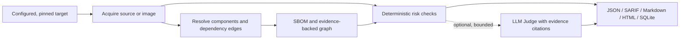

# Supply Chain Guardian

**Evidence-backed software supply-chain inventory and risk detection.**

Built for the **Bosch x Amrita BD Hackathon**, Problem Statement 1: Agentic AI
Solution for Software Supply-Chain Management. The primary demo target is
[Eclipse KUKSA Databroker](https://github.com/eclipse-kuksa/kuksa-databroker).

> **Project status:** Checkpoint 1 (inventory and dependency graph) is complete.
> Checkpoint 2 (risk detection) is implemented and under final review; its
> documented local acceptance run passes 74 tests. Visual QA remains pending.
> Prioritisation and remediation checkpoints are planned, not implemented.

## What it does today

- Acquires configured repositories at pinned revisions without executing target
  code.
- Resolves Cargo and Python dependencies, builds dependency graphs, and generates
  CycloneDX and SPDX SBOMs.
- Runs deterministic checks for vulnerabilities, dependency changes, registry
  metadata, suspicious package-name similarity, build-time capabilities,
  workflows, and container images.
- Writes findings with initial severity, dependency paths, and evidence references
  to JSON, SARIF, Markdown, HTML, and SQLite outputs.
- Optionally asks a bounded LLM Judge to assess selected findings. Its assessments
  must cite evidence and cannot override deterministic severity.

Guardian is a review aid, not a malware verdict: static findings can be false
positives and do not by themselves prove malicious intent, exploitability, or
runtime reachability.

## Architecture



Detection and reports are implemented. Scoring by reachability/exposure, policy
decisions, automated remediation, sandboxed fix validation, and a user interface
are future work.

## Targets

Targets are configured in [targets.yaml](targets.yaml) and pinned to repository
revisions or an image digest.

| Target | Purpose |
|---|---|
| `kuksa-databroker` | Main Rust repository target at tag `0.7.2` |
| `kuksa-val-0.4.1` | Audited baseline used for comparison |
| `kuksa-python-sdk` | Python dependency inventory and detection target |
| `kuksa-python-sdk-baseline` | Previous SDK release for comparison |
| `kuksa-databroker-image` | Pinned container image inventory |

The scanner is designed around configured ecosystems rather than a hard-coded
single repository. Current adapters cover Cargo, Python, and container images.

## Technology

- **Application:** Python 3.12, `uv`, Typer, Pydantic
- **Graph and storage:** NetworkX, SQLite, Pyvis
- **Inventory and validation:** Cargo metadata, CycloneDX, SPDX, Syft
- **Risk detection:** OSV-Scanner, cargo-audit, pip-audit, Grype, zizmor,
  GuardDog, Semgrep, and project-specific checks
- **Tests and quality:** pytest, Ruff, GitHub Actions

Exact Python pins and hashes are in [uv.lock](uv.lock); scanner versions and
checksums are in [tools.lock.md](tools.lock.md).

## Repository layout

```text
guardian/
  adapters/       Cargo, Python, and container inventory
  detect/         Deterministic risk checks and report generation
  graph/          Dependency graph construction, storage, and queries
  llm/            Optional bounded Judge
demo/             Demo preparation and analysis
rules/            Severity and Semgrep rules
tests/            Unit and integration tests
docs/             Checkpoint evidence and technology decisions
workspace/        Local target checkouts and caches (ignored)
out/              Generated reports and evidence (ignored)
```

## Requirements and setup

The documented development environment is Windows PowerShell with Python 3.12,
`uv`, Git, Rust/Cargo, and Docker Desktop using its Linux engine. Docker is needed
for the pinned containerized static scanners. Some acquisition and registry
checks need network access.

From the repository root:

```powershell
. .\scripts\activate-tools.ps1
uv sync --locked
```

For optional live LLM assessments, copy `.env.example` to `.env` and set
`LLM_API_KEY`, `LLM_BASE_URL`, and `LLM_MODEL`. `.env` is ignored by Git; do not
commit credentials. No live LLM call is required for normal scans or CI.

## Usage

```powershell
# Build the SBOM and dependency graph
uv run guardian scan --target kuksa-databroker

# Query dependency paths
uv run guardian path --target kuksa-databroker h2
uv run guardian path --reverse mdurl --target kuksa-python-sdk

# Run deterministic risk checks
uv run guardian detect --target kuksa-databroker --baseline kuksa-val-0.4.1
uv run guardian detect --target kuksa-python-sdk

# Inspect a finding and its evidence chain
uv run guardian finding F-a2c6fab20207 --target kuksa-databroker

# Run one explicit provider/model connectivity check (uses the configured .env)
uv run guardian judge-ping
```

`guardian detect` is deterministic by default. Add `--judge` only when the
redacted outgoing payload is approved. The optional live call is bounded by the
configured limit in [guardian.yaml](guardian.yaml).

Generated artifacts are written beneath `out/<target>/`. For the complete
Checkpoint 2 workflow and test prerequisites, including the inert planted
fixture, see [docs/CHECKPOINT-2.md](docs/CHECKPOINT-2.md).

## Outputs and evidence

Inventory runs generate CycloneDX and SPDX SBOMs, graph exports, a summary,
SQLite storage, and scan/evidence records. Risk detection adds:

- `findings.json` and `findings.sarif`
- `risk_report.md` and `risk_report.html`
- SQLite finding, vulnerability, evidence, and typed risk-relationship records
- Raw scanner outputs referenced by evidence records

Evidence records identify the producing tool and version, command, timestamp,
raw output path, and SHA-256 digest. Reports link findings to dependency paths
and their supporting evidence. See [docs/CHECKPOINT-1.md](docs/CHECKPOINT-1.md)
and [docs/CHECKPOINT-2.md](docs/CHECKPOINT-2.md) for verified outputs and
acceptance details.

## Safety and limitations

- Target packages and source are treated as data; the workflow does not build or
  run target code.
- The planted demo fixture is local and inert. It is not built, executed, or
  published.
- Containerized scanners use pinned images and restrictive settings documented
  in the project configuration.
- Capability rules are static heuristics and may flag legitimate build scripts.
- Registry metadata may be unavailable; unknown values are not interpreted as
  negative facts.
- The LLM Judge is optional and may fail or be unavailable. Deterministic
  findings remain available for human review.
- There is no implemented priority score, automatic dependency fix, or automatic
  merge.

## Roadmap

| Checkpoint | Scope | Status |
|---|---|---|
| 1 | Pinned acquisition, SBOM, dependency graph, evidence | Complete |
| 2 | Dependency, vulnerability, source, workflow, and image risk detection | Implemented; final visual QA pending |
| 3 | Reachability/exposure prioritisation and explainable scores | Planned |
| 4 | Vetted remediation candidates and human approval | Planned |
| 5 | Isolated fix validation, rescan, and before/after reporting | Planned |
| 6 | User interface and demo polish | Planned |

See [docs/CHECKPOINT-1.md](docs/CHECKPOINT-1.md),
[docs/CHECKPOINT-2.md](docs/CHECKPOINT-2.md), and
[docs/TECH_STACK.md](docs/TECH_STACK.md) for detailed project records.

## References

- [Eclipse KUKSA](https://eclipse-kuksa.github.io/kuksa-website/)
- [OSV-Scanner](https://google.github.io/osv-scanner/) and [OSV.dev](https://osv.dev/)
- [CycloneDX](https://cyclonedx.org/) and [SPDX](https://spdx.dev/)
- [Syft](https://github.com/anchore/syft)
